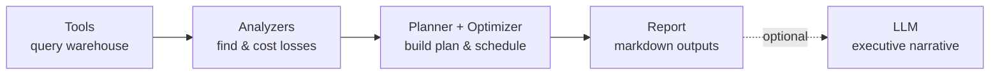

# Agent

A **tool-using agent** that analyses the sensor data, **quantifies inefficiencies in €**,
and **generates a production plan**.

## Key properties

| Property | Detail |
|---|---|
| **Offline by default** | Runs fully on a deterministic engine — reproducible results |
| **LLM-optional** | If credentials are present, adds an executive narrative |
| **Explainable** | Produces a reasoning trace alongside the plan |
| **Two interfaces** | CLI (`python -m agent.run_agent`) and the dashboard Agent tab |

## Sections

- [Workflow](workflow.md)
- [Modules](modules.md)
- [Production Optimizer](optimizer.md)
- [LLM Narrative](llm.md)
- [CLI Reference](cli.md)
- [Outputs](outputs.md)
