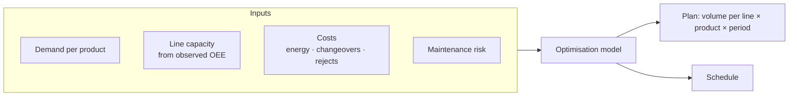

# Production Optimizer

The optimizer (`agent/optimizer.py`) turns **demand** and **plant capability** into a
**production plan**.

## Problem framing

## Conceptual formulation

**Decision variables** — how much of each product to make on each line in each period.

**Objective** — minimise total cost (or maximise value) of meeting demand:

$$
\min \sum_{l,p,t} c_{l,p}\, x_{l,p,t} \;+\; \text{changeover costs} \;+\; \text{penalties}
$$

**Constraints** (typical)

- Demand coverage over the horizon
- Line capacity per period, based on realistic (observed) performance
- Product–line compatibility
- Changeover and maintenance considerations

!!! note
    This page describes the model conceptually. See `agent/optimizer.py` for the exact
    variables, constraints, objective and solver used.

## Why it matters

Using **observed** OEE rather than nameplate capacity makes the plan feasible in
practice — the optimizer plans for the plant as it really performs, while the
diagnosis shows how much capacity could be recovered.
