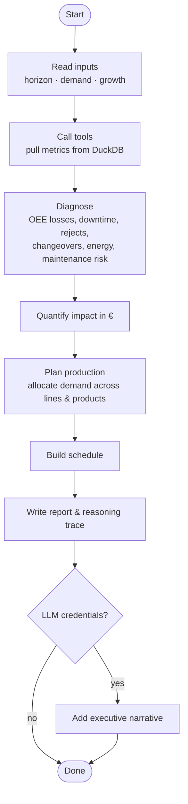

# Agent Workflow

## Steps

1. **Inputs** — planning horizon (default 28 days), demand per product family or a growth factor.
2. **Tools** — the agent calls tools (`tools.py`) that query the warehouse.
3. **Diagnosis** — analyzers (`analyzers.py`) identify where capacity and money are lost.
4. **Quantification** — each inefficiency is expressed in **€**, so priorities are comparable.
5. **Planning** — the planner (`planner.py`) and optimizer (`optimizer.py`) produce a plan that meets demand.
6. **Reporting** — `report.py` writes the efficiency report, plan, schedule and trace.
7. **Narrative (optional)** — `llm.py` summarises the result for executives.
