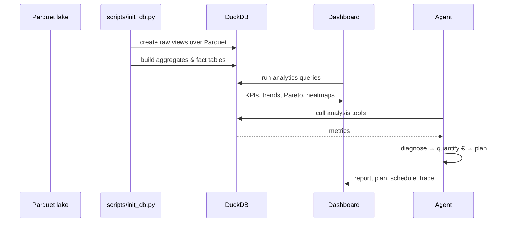

# Data Flow

## Stages

1. **Ingest (virtual)** — `sql/01_raw_views.sql` exposes `raw_sensor`, `dim_machine`, `dim_product`, `raw_schedule`.
2. **Aggregate** — `sql/02_build_aggregates.sql` produces hourly/daily roll-ups and episode-level fact tables.
3. **Analyse** — `sql/analytics/*.sql` compute OEE, downtime, quality, energy and maintenance metrics.
4. **Consume** — the dashboard visualises; the agent reasons and plans.
