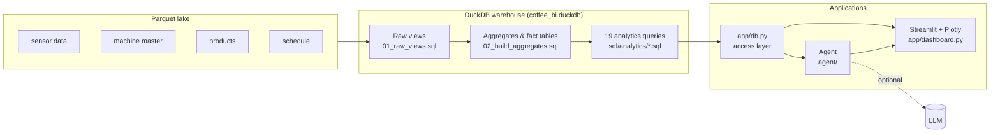

# Architecture

The solution is **self-contained**: no external database server and no cloud dependency
for the core analytics or the agent's deterministic engine.

## Design principles

| Principle | How it shows up |
|---|---|
| **Query in place** | DuckDB reads Parquet directly through views — no ETL copy. |
| **Pay once for heavy work** | Expensive roll-ups are materialised once into compact tables. |
| **SQL as a library** | Analytics are versioned, self-documenting `.sql` files reused by UI and agent. |
| **Deterministic first** | The agent's analysis and plan don't depend on an LLM. |
| **LLM as narrator** | When available, the LLM explains — it does not compute. |

## Sections

- [Data Flow](data-flow.md)
- [Repository Structure](repository-structure.md)
