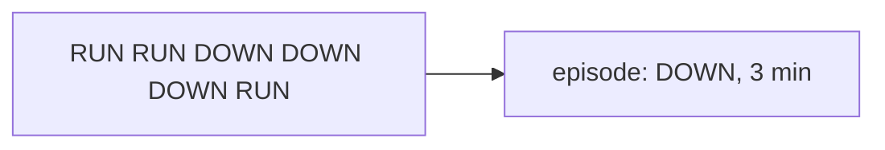

# Aggregates & Fact Tables

Defined in `sql/02_build_aggregates.sql`. Heavy computations run **once** and are
stored as compact tables, so dashboards and the agent stay fast.

| Table | Grain | Used for |
|---|---|---|
| `agg_machine_hour` | machine × hour | Intraday patterns, heatmaps |
| `agg_machine_day` | machine × day | Trends, OEE, reliability |
| `agg_line_product_day` | line × product × day | Output, yield, energy by product |
| `fact_downtime_episode` | one row per downtime episode | Pareto, MTBF / MTTR |
| `fact_changeover_episode` | one row per changeover | Changeover matrix & losses |

## Gaps-and-islands

Downtime and changeover **episodes** are derived from minute-level states using the
*gaps-and-islands* pattern: consecutive minutes in the same state are collapsed into a
single episode with a start, end and duration.

