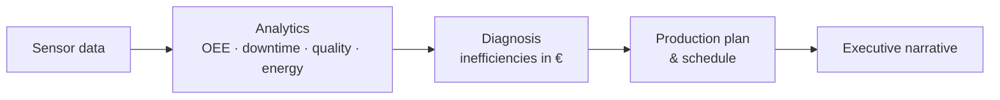

# :coffee: Coffee Capsule Production Optimizer Agent

**An agentic Business Intelligence application for a coffee-capsule production plant.**
It analyses sensor data, quantifies inefficiencies in **€**, and generates a **production plan**.

-   :material-rocket-launch: **Getting Started**

    ---
    Install, build the DuckDB warehouse, and launch the dashboard in minutes.

    [:octicons-arrow-right-24: Quick start](getting-started/index.md)

-   :material-sitemap: **Architecture**

    ---
    Parquet lake → DuckDB warehouse → Streamlit dashboard → Agent.

    [:octicons-arrow-right-24: Architecture](architecture/index.md)

-   :material-chart-line: **Analytics**

    ---
    A library of 19 self-documenting analytical SQL queries.

    [:octicons-arrow-right-24: Analytics](analytics/index.md)

-   :material-robot: **Agent**

    ---
    A tool-using agent that diagnoses, quantifies and plans — fully offline, with an optional LLM narrative.

    [:octicons-arrow-right-24: Agent](agent/index.md)

## The business problem

Coffee-capsule plants run high-speed, multi-stage lines where small losses — micro-stops,
slow changeovers, rejects, energy waste, unplanned failures — compound into significant cost.
The data to see these losses exists (minute-level sensor readings), but turning it into
**decisions** requires analytics, domain logic and planning.

This project closes that loop:

## The dataset at a glance

| Item | Value |
|---|---|
| Production lines | 3 |
| Machines | 51 |
| Sensor granularity | 1 minute |
| Period | One full year |
| Volume | ~26.8 M rows (Parquet) |
| Nature | Synthetic |

## Tech stack

| Layer | Technology |
|---|---|
| Storage | Parquet data lake |
| Warehouse / query engine | DuckDB |
| Analytics | SQL (views, aggregates, gaps-and-islands fact tables) |
| UI | Streamlit + Plotly |
| Agent | Python, deterministic engine + optional LLM |

!!! tip "Two ways to use it"
    - **Explore** — use the Streamlit dashboard to browse KPIs, Pareto charts, heatmaps and run SQL.
    - **Decide** — run the agent to get a diagnosis, a plan and a reasoning trace.
